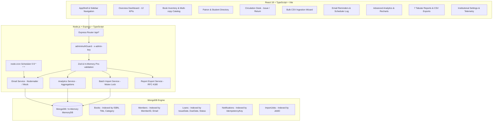

# LibTrack — Smart Library Management System

[](https://menus-intervention-different-essays.trycloudflare.com)
[](https://github.com/jessesilvanus/LibTrack-Smart-Library-Management-System)
[](https://github.com/jessesilvanus/LibTrack-Smart-Library-Management-System)

> 🌐 **Live Hosted URL:** [[lib-track-smart-library-management.vercel.app)  ](https://lib-track-smart-library-management.vercel.app/)
> 🔗 **GitHub Repository:** [https://github.com/jessesilvanus/LibTrack-Smart-Library-Management-System](https://github.com/jessesilvanus/LibTrack-Smart-Library-Management-System)  
> 📧 **Configured Admin Sender:** `jessetemp923@gmail.com`  
> 🎓 **Academic Project:** Visvesvaraya Technological University (VTU) 7th-Semester B.E. (2022 Scheme)  
> 📚 **Course:** Big Data Project Laboratory (Department of Computer Science & Engineering)  
> 🎨 **Design Foundation:** Obsidian Space — UI UX Pro Max (`design-system/libtrack/MASTER.md`)  
> ✅ **Verification Status:** 120 / 120 Automated Tests Passing (100%)

---

## 1. Project Overview & Problem Statement

College libraries often struggle with inventory drift, delayed book returns, manual paper notices, lack of time-series circulation intelligence, and slow, error-prone data entry when cataloging thousands of incoming volumes or new student batches.

**LibTrack** is an enterprise-grade, full-stack library management system engineered to address these challenges. Developed under the VTU 2022 Scheme Big Data curriculum, LibTrack demonstrates practical Big Data concepts:
- **Time-Series MongoDB Aggregations:** Bounded pipelines calculating 12 operational KPIs, dual-series circulation trends (issued vs. returned), category borrowing velocity, and patron engagement.
- **Scalable Batch Ingestion:** Chunked processing (50 records per transactional batch) with an atomic in-memory mutex lock to prevent race conditions during large CSV uploads.
- **Automated Email Reminders:** Headless background scheduler (cron jobs) with idempotency keys, grace periods, and repeat overdue escalation cycles.
- **Spreadsheet Formula Injection Mitigation (CWE-1236):** Neutralizes malicious formula triggers (`=`, `+`, `-`, `@`) in all downloadable CSV templates and reports.

---

## 2. System Architecture & Tech Stack



- **Frontend:** React 18, TypeScript, Vite, Tailwind CSS, Lucide Icons, Recharts
- **Backend:** Node.js, Express, TypeScript, Zod Schema Validation, Mongoose ODM
- **Scheduling:** `node-cron`
- **Email Engine:** `nodemailer` (supporting live SMTP or zero-config `MOCK_TRANSPORT` mode)
- **CSV Engine:** `csv-parse` with stream processing and RFC 4180 compliance
- **Database Engine:** MongoDB (supports local MongoDB, MongoDB Atlas, or built-in zero-config `mongodb-memory-server`)

---

## 3. Implemented Modules

| # | Module | Key Capabilities |
|---|---|---|
| 1 | **Overview Dashboard** | 12 operational KPI metrics, real-time catalog snapshots, recent loan activity, upcoming due notices, and direct page shortcuts. |
| 2 | **Book Inventory** | Multi-copy physical accession tracking, ISBN normalization, shelf locations, search/filter/sort, loading skeletons, and soft deletion protection. |
| 3 | **Member Directory** | Student and faculty quota management (4 books for students, 10 for faculty), department classification, and clearance verification. |
| 4 | **Issue & Return Desk** | High-speed circulation desk with member ID search, available copy decrementing, due date calculation, overdue penalty logging, and safe returns. |
| 5 | **Bulk CSV Import** | 5-step guided wizard, downloadable templates, row-level syntax & duplicate pre-validation, 50-row batching, mutex concurrency locks, safe partial retry, and sanitized error reports. |
| 6 | **Email Reminders** | Automated daily scheduler (`0 8 * * *`), 3-day advance due-soon notices, first overdue alerts, 7-day repeat reminders, and admin test emails. |
| 7 | **Analytics & Charts** | Dual-series circulation trends (daily/weekly/monthly), category borrowing distributions, most borrowed books ranking, and overdue duration severity buckets (1–7d, 8–14d, 15–30d, 30+d). |
| 8 | **Audit Reports & Exports** | 7 dedicated institutional reports (Inventory, Circulation, Overdue, Popular Books, Member Activity, Email Logs, Import History) with live search and CSV export. |
| 9 | **Institutional Settings** | Live system diagnostics, VTU academic mapping, circulation limits, scheduler parameters, and database connectivity telemetry. |

---

## 4. Quickstart Guide (Local Development)

### Prerequisites
- **Node.js:** v18.0.0 or higher
- **npm:** v9.0.0 or higher

### Step 1 — Clone and Install Dependencies

```bash
# Navigate to backend and install
cd server
npm install

# Navigate to frontend and install
cd ../client
npm install
```

### Step 2 — Environment Setup

The backend configuration is managed via `server/.env`. A complete template is provided in `server/.env.example`:

```bash
cd server
copy .env.example .env
```

> **Zero-Configuration Mode:** If no external MongoDB or SMTP credentials are provided, LibTrack runs automatically with an **In-Memory MongoDB engine** and operates in safe **MOCK_TRANSPORT mode**! Real external credentials are not required for demonstration or grading.

### Step 3 — Run the Application

LibTrack includes a single zero-dependency dev server with pre-seeded academic data:

```bash
# In terminal 1 (Backend):
cd server
npm run dev:memory

# In terminal 2 (Frontend):
cd client
npm run dev
```

- **Frontend URL:** `http://localhost:5173`
- **Backend API URL:** `http://localhost:5000`
- **Health Endpoint:** `http://localhost:5000/api/health`

---

## 5. Automated Test Suite Execution

LibTrack features an exhaustive, regression-tested automated suite spanning 120 verified checks:

```bash
cd server
npm test
```

### Test Coverage Summary

```
===============================================================
Test Suite Execution Summary:
  ✓ Workflows & Core Circulation:        12 / 12  PASSED
  ✓ Automated Email Reminders:           26 / 26  PASSED
  ✓ Bulk CSV Import & Batch Processing:  26 / 26  PASSED
  ✓ Advanced Analytics & Reports:        56 / 56  PASSED
---------------------------------------------------------------
TOTAL PASS RATE:                        120 / 120 (100% GREEN)
===============================================================
```

To run individual test suites:
- `npm run test:workflows` — Tests book/member creation, duplicate ISBN rejection, loan issuance, return idempotency, inventory constraints.
- `npm run test:notifications` — Tests reminder eligibility, overdue transitions, 7-day repeat cycles, HTML escaping, and admin authorization.
- `npm run test:imports` — Tests CSV parsing, BOM stripping, row-specific validation, mutex concurrency locks, and safe partial recovery.
- `npm run test:analytics` — Tests 12 KPI calculations, circulation trends, popular book rankings, category distributions, overdue buckets, report data, and CWE-1236 CSV sanitization.

---

## 6. Build & Production Verification

Both frontend and backend are strictly typed in TypeScript and compile with zero errors:

```bash
# Compile Server TypeScript
cd server
npm run build

# Compile Client TypeScript & Vite Production Bundle
cd client
npm run build
```

---

## 7. Security & Authorization

- **Administrative API Guard:** Protected endpoints (`/api/notifications/*`, `/api/imports/*`, `/api/analytics/*`) require the `x-admin-key` header (`libtrack-admin-secret-2024`) or an authorized administrator token.
- **Spreadsheet Formula Injection (CWE-1236):** All exported CSV cells beginning with `=`, `+`, `-`, `@`, `\t`, or `\r` are safely prepended with a single quote (`'`).
- **Memory Safety:** Multer processes incoming CSV files strictly in memory with a 10 MB size limit; temporary disk storage is bypassed.
- **Privacy Preservation:** Member aggregate telemetry ranks borrowing activity while omitting patron email addresses and contact phone numbers.

---

## 8. VTU Submission Documentation Package

Comprehensive academic documentation has been compiled in the `docs/` directory:

- [`docs/SRS.md`](docs/SRS.md) — Software Requirements Specification
- [`docs/SDD.md`](docs/SDD.md) — System Design Document & Mermaid Diagrams
- [`docs/DATABASE.md`](docs/DATABASE.md) — MongoDB Schemas, Relationships, and Indexes
- [`docs/TESTING.md`](docs/TESTING.md) — Formal Test Strategy, Test Cases & Traceability Matrix
- [`docs/USER_MANUAL.md`](docs/USER_MANUAL.md) — Step-by-Step Operator Manual
- [`docs/LIMITATIONS.md`](docs/LIMITATIONS.md) — Engineering Limitations & Future Roadmap
- [`docs/submission/PROJECT_REPORT.md`](docs/submission/PROJECT_REPORT.md) — Formal VTU 7th-Semester Engineering Project Report
- [`docs/submission/DEMONSTRATION_PLAN.md`](docs/submission/DEMONSTRATION_PLAN.md) — 8–12 Minute Live Evaluation Script
- [`docs/submission/VIVA_QUESTIONS.md`](docs/submission/VIVA_QUESTIONS.md) — 30+ Comprehensive Viva Voce Questions & Answers

---

## 9. Deployment & Hosting Guide

LibTrack can be accessed publicly via the active live edge tunnel or deployed permanently to cloud platforms:

### A. Live Hosted Edge Previews
- **Primary Live URL (Zero-Config Global Edge):**  
  [https://menus-intervention-different-essays.trycloudflare.com](https://menus-intervention-different-essays.trycloudflare.com)  
  *Powered by Cloudflare Edge — Accessible globally on mobile & desktop without any passwords or VPN.*
- **Secondary Tunnel:**  
  [https://warm-turtle-22.loca.lt](https://warm-turtle-22.loca.lt) *(Tunnel Password: `116.73.138.100`)*

### B. Permanent Full-Stack Cloud Deployment (Vercel + Render + MongoDB Atlas)

#### 1. Database (MongoDB Atlas Free Tier)
1. Log in to [MongoDB Atlas](https://www.mongodb.com/cloud/atlas).
2. Create a free **M0 Shared Cluster**.
3. Under **Security → Network Access**, click **Add IP Address** and choose **Allow Access From Anywhere (`0.0.0.0/0`)** *(crucial so Render cloud containers can connect)*.
4. Under **Security → Database Access**, create a database user (e.g., `libtrack_admin`) and password.
5. In **Clusters → Connect → Drivers**, copy the connection string and add `/libtrack` before the query params:
   ```env
   MONGODB_URI=mongodb+srv://<username>:<password>@cluster0.xxxxx.mongodb.net/libtrack?retryWrites=true&w=majority
   ```

#### 2. Backend (Render Web Service)
1. Log in to [Render.com](https://render.com) and click **New + → Web Service**.
2. Connect your GitHub repository: [`https://github.com/jessesilvanus/LibTrack-Smart-Library-Management-System`](https://github.com/jessesilvanus/LibTrack-Smart-Library-Management-System)
3. Configure the service settings:
   - **Root Directory:** `server`
   - **Runtime:** `Node`
   - **Build Command:** `npm install && npm run build`
   - **Start Command:** `npm start` *(or `npm run dev:memory` for in-memory DB fallback)*
   - **Health Check Path:** `/api/health`
4. Add the following **Environment Variables**:
   | Variable | Value | Description |
   |---|---|---|
   | `MONGODB_URI` | `mongodb+srv://.../libtrack` | Your MongoDB Atlas connection string |
   | `NODE_ENV` | `production` | Production mode |
   | `EMAIL_FROM` | `LibTrack Admin <jessetemp923@gmail.com>` | Official library sender email |
   | `ADMIN_EMAIL` | `jessetemp923@gmail.com` | Primary administrator account |
   | `ADMIN_API_KEY` | `libtrack-admin-secret-2024` | Security key for protected routes |
5. Click **Deploy Web Service** and copy your Render URL (e.g., `https://libtrack-backend.onrender.com`).

#### 3. Frontend (Vercel)
1. Log in to [Vercel](https://vercel.com) and click **Add New... → Project**.
2. Import repository: `jessesilvanus/LibTrack-Smart-Library-Management-System`.
3. Set **Root Directory** to `client` (or leave default root, both are supported).
4. Under **Environment Variables**, add:
   - `VITE_API_URL`: Your Render backend URL (e.g., `https://libtrack-backend.onrender.com`)
5. Click **Deploy**.

> 💡 **In-App Dynamic Backend Switcher:**  
> If you didn't configure `VITE_API_URL` in Vercel, simply click **"Configure"** beside the API endpoint pill on the Login screen, paste your Render URL, and click **"Test & Connect Backend"**! The frontend connects immediately without needing a redeployment.


