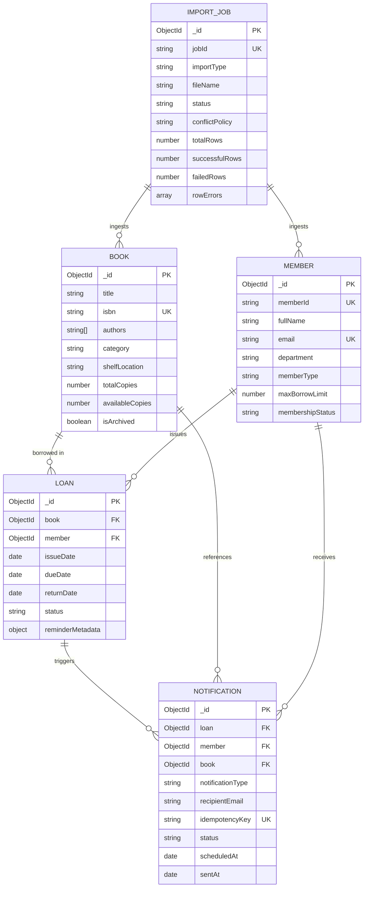

# Database Schema & Data Integrity Documentation

## LibTrack — Smart Library Management System
**Academic Project:** Visvesvaraya Technological University (VTU)  
**Database Engine:** MongoDB v6.0+ / In-Memory MongoDB Server  
**Object Data Modeling (ODM):** Mongoose v8.7.0  
**Document Version:** 1.0 (Final Submission Candidate)

---

## 1. Entity-Relationship & Collection Overview

LibTrack organizes academic library data across five core collections. Referenced relationships use MongoDB `ObjectId` with Mongoose population.

---

## 2. Detailed Collection Schemas

### 2.1 Collection: `books`
Stores the central catalog of unique titles, accession counts, and shelf locations.

| Field Name | BSON Type | Constraints & Rules | Description |
|---|---|---|---|
| `_id` | ObjectId | Primary Key (Auto-generated) | Unique document identifier |
| `title` | String | Required, trimmed, max 200 chars | Full bibliographic book title |
| `isbn` | String | Required, unique, normalized | ISBN-10 or ISBN-13 without hyphens |
| `authors` | Array of Strings | Required, min 1 author | List of author names |
| `category` | String | Required, indexed | Academic discipline or category |
| `publisher` | String | Optional | Publishing house |
| `publicationYear` | Number | Optional, $1450 \le year \le current + 1$ | Year of publication |
| `shelfLocation` | String | Required, default `'Main Stack'` | Physical shelf or aisle code |
| `totalCopies` | Number | Required, integer $\ge 1$ | Total physical copies accessioned |
| `availableCopies` | Number | Required, integer $0 \le available \le total$ | Copies ready on shelf |
| `isArchived` | Boolean | Default `false` | Soft-deletion flag |
| `createdAt` | Date | Auto-timestamp | Record creation timestamp |
| `updatedAt` | Date | Auto-timestamp | Last update timestamp |

**Indexes:**
- `{ isbn: 1 }` (Unique)
- `{ category: 1 }`
- `{ title: 'text', authors: 'text', isbn: 'text' }` (Full-text search index)

---

### 2.2 Collection: `members`
Stores student, faculty, and staff records with academic borrowing quotas.

| Field Name | BSON Type | Constraints & Rules | Description |
|---|---|---|---|
| `_id` | ObjectId | Primary Key | Unique document identifier |
| `memberId` | String | Required, unique, uppercase | College USN or Employee ID (e.g. `STU-2026-1001`) |
| `fullName` | String | Required, trimmed | Patron's full legal name |
| `email` | String | Required, unique, lowercase, regex | Academic email address |
| `department` | String | Required | Department (e.g. `Computer Science & Engineering`) |
| `contactNumber`| String | Optional | Phone number |
| `memberType` | String | Enum: `['STUDENT', 'FACULTY', 'STAFF']` | Membership tier |
| `maxBorrowLimit`| Number | Required, default: 4 (Student), 10 (Faculty) | Maximum concurrent active loans |
| `membershipStatus`| String | Enum: `['ACTIVE', 'EXPIRED', 'SUSPENDED']` | Current clearance status |
| `isArchived` | Boolean | Default `false` | Soft-deletion flag |

**Indexes:**
- `{ memberId: 1 }` (Unique)
- `{ email: 1 }` (Unique)
- `{ department: 1 }`
- `{ membershipStatus: 1 }`

---

### 2.3 Collection: `loans`
Tracks physical book circulation, due dates, check-ins, and overdue reminders.

| Field Name | BSON Type | Constraints & Rules | Description |
|---|---|---|---|
| `_id` | ObjectId | Primary Key | Unique document identifier |
| `book` | ObjectId | Required, ref: `'Book'` | Reference to borrowed book |
| `member` | ObjectId | Required, ref: `'Member'` | Reference to borrowing patron |
| `copyIdentifier`| String | Default `'Copy #1'` | Accession barcode or copy tag |
| `issueDate` | Date | Required, default `Date.now` | Date and time book was checked out |
| `dueDate` | Date | Required, indexed | Authoritative return deadline |
| `returnDate` | Date | Default `null`, indexed | Actual date returned |
| `status` | String | Enum: `['ACTIVE', 'RETURNED', 'OVERDUE']` | Circulation status |
| `reminderMetadata.reminderCount` | Number | Default 0 | Count of email reminders dispatched |
| `reminderMetadata.lastReminderSentAt` | Date | Default `null` | Timestamp of last reminder |
| `notes` | String | Optional | Condition notes upon checkout |

**Compound Indexes:**
- `{ status: 1, dueDate: 1 }` (High-speed overdue detection)
- `{ member: 1, status: 1 }` (Active quota verification)
- `{ book: 1, status: 1 }` (Inventory safety verification)
- `{ issueDate: 1, status: 1 }` (Time-series circulation aggregation)
- `{ returnDate: 1, status: 1 }` (Return velocity aggregation)

---

### 2.4 Collection: `notifications`
Audit trail of automated email reminders, test dispatches, and SMTP delivery states.

| Field Name | BSON Type | Constraints & Rules | Description |
|---|---|---|---|
| `_id` | ObjectId | Primary Key | Unique document identifier |
| `loan` | ObjectId | Optional, ref: `'Loan'` | Associated loan record |
| `member` | ObjectId | Optional, ref: `'Member'` | Recipient patron reference |
| `book` | ObjectId | Optional, ref: `'Book'` | Associated book reference |
| `notificationType` | String | Enum: `['DUE_SOON', 'FIRST_OVERDUE', 'REPEAT_OVERDUE', 'TEST']` | Type of notification |
| `recipientEmail` | String | Required | Email address sent to |
| `idempotencyKey` | String | Required, unique | Hash preventing duplicate dispatches |
| `status` | String | Enum: `['PENDING', 'SENT', 'FAILED', 'SKIPPED']` | Delivery status |
| `attemptCount` | Number | Default 1 | Number of dispatch attempts |
| `errorSummary` | String | Optional | SMTP error message if failed |
| `scheduledAt` | Date | Required | Scheduled time |
| `sentAt` | Date | Default `null` | Dispatch timestamp |

**Indexes:**
- `{ idempotencyKey: 1 }` (Unique)
- `{ status: 1, notificationType: 1 }`
- `{ createdAt: -1 }`

---

### 2.5 Collection: `importjobs`
Records bulk CSV data ingestion jobs, parsing statistics, and row errors.

| Field Name | BSON Type | Constraints & Rules | Description |
|---|---|---|---|
| `_id` | ObjectId | Primary Key | Unique document identifier |
| `jobId` | String | Required, unique | Human-readable ID (e.g. `IMP-20261015-INITBOOKS`) |
| `importType` | String | Enum: `['BOOKS', 'MEMBERS']` | Ingestion target collection |
| `fileName` | String | Required | Original upload filename |
| `fileSize` | Number | Required | Size in bytes |
| `submittedBy` | String | Default `'Librarian'` | Administrator username |
| `status` | String | Enum: `['PENDING', 'VALIDATING', 'READY', 'PROCESSING', 'COMPLETED', 'COMPLETED_WITH_ERRORS', 'FAILED']` | Ingestion lifecycle state |
| `conflictPolicy` | String | Enum: `['SKIP_DUPLICATES', 'REJECT_CONFLICTS', 'UPDATE_EXISTING']` | Conflict resolution rule |
| `totalRows` | Number | Required | Total rows parsed from CSV |
| `validRows` | Number | Required | Valid candidate rows |
| `invalidRows` | Number | Required | Rows failing syntax or business rules |
| `successfulRows`| Number | Required | Records written to database |
| `skippedRows` | Number | Required | Duplicate records bypassed |
| `failedRows` | Number | Required | Rows encountering database write errors |
| `rowErrors` | Array of Objects | Structured | Row number, column field, error code, message |
| `startedAt` | Date | Optional | Batch processing start time |
| `completedAt` | Date | Optional | Batch processing finish time |

**Indexes:**
- `{ jobId: 1 }` (Unique)
- `{ status: 1, importType: 1 }`
- `{ createdAt: -1 }`

---

## 3. Data Integrity & Invariant Rules

1. **Available Copies Invariant:**  
   $$0 \le \text{availableCopies} \le \text{totalCopies}$$  
   Decremented on checkout, incremented on return. Total copies cannot be updated below the count of active loans.
2. **Return Idempotency Invariant:**  
   Loans with `status === 'RETURNED'` cannot be returned a second time.
3. **No Duplicate Overdue Reminder Invariant:**  
   A unique compound idempotency key guarantees that a loan receives at most one advance due-soon notice and at most one overdue notice per 7-day interval.
4. **Formula Injection Sanitization:**  
   Any cell value exported to CSV starting with `=`, `+`, `-`, `@`, `\t`, or `\r` is prepended with a single quote to protect downstream spreadsheet applications.
