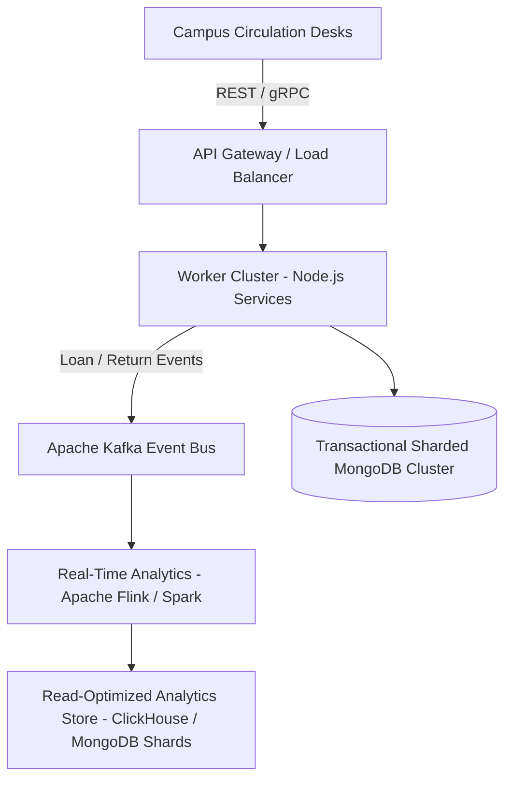

# Engineering Limitations & Future Roadmap

## LibTrack — Smart Library Management System
**Academic Project:** Visvesvaraya Technological University (VTU)  
**Degree:** B.E. in Computer Science & Engineering (2022 Scheme)  
**Document Version:** 1.0 (Final Submission Candidate)

---

## 1. Current Engineering Limitations

1. **Single-Node In-Memory Concurrency Mutex:**
   - *Current Implementation:* The batch import service uses an in-memory `Set<string>` mutex (`activeJobs`) to lock jobs on a single Node.js process.
   - *Limitation:* If the application is scaled horizontally across multiple Node.js cluster instances or Kubernetes pods, the in-memory set is not shared across nodes.
   - *Future Solution:* Introduce Redis-based distributed locking (e.g., Redlock) for multi-pod deployment.

2. **Email Provider Acceptance vs. Inbox Delivery:**
   - *Current Implementation:* Notifications transition to `SENT` when the local Nodemailer transport receives an `HTTP 250 OK` acknowledgment from the SMTP gateway.
   - *Limitation:* SMTP acknowledgment confirms transmission to the receiving mail transfer agent (MTA), but does not guarantee that the student's email inbox did not mark the message as spam or reject it due to full storage.
   - *Future Solution:* Integrate webhooks from transactional email providers (e.g., Amazon SES or SendGrid) to track bounce and open events.

3. **CSV Export In-Memory Buffering Bounds:**
   - *Current Implementation:* CSV exports are bounded to a maximum of 5,000 records per export request to prevent heap memory exhaustion.
   - *Limitation:* Exporting institutional catalogs with over 100,000 records cannot be downloaded in a single file without HTTP streaming.
   - *Future Solution:* Implement HTTP chunked transfer streaming with Node.js Transform streams for unbounded datasets.

4. **Synchronous Full-Text Search:**
   - *Current Implementation:* Full-text search across titles, authors, and ISBNs uses MongoDB `$regex` and compound text indexes.
   - *Limitation:* For multi-million document collections, `$regex` queries without leading anchors require significant disk I/O.
   - *Future Solution:* Integrate Elasticsearch or MongoDB Atlas Search for fuzzy matching and typo-tolerant search.

---

## 2. Big Data Scaling Roadmap for Multi-Campus Deployments

For statewide deployment across all affiliated VTU engineering colleges (over 200 institutions with millions of physical holdings):

1. **Message Broker Integration (Apache Kafka):** Decouple checkout and check-in transactions by publishing loan events to Kafka topics (`library.circulation.issued`, `library.circulation.returned`).
2. **Distributed Stream Analytics (Apache Spark / Flink):** Ingest circulation streams to generate real-time heatmaps of campus reading trends and automated inter-library loan recommendations.
3. **RFID & IoT Smart Gate Integration:** Connect UHF RFID gates to automatically scan books upon entry/exit, removing manual desk scanning.
4. **Automated WhatsApp / SMS Gateway:** Complement email reminders with instant WhatsApp Business API notifications for higher student open rates.
