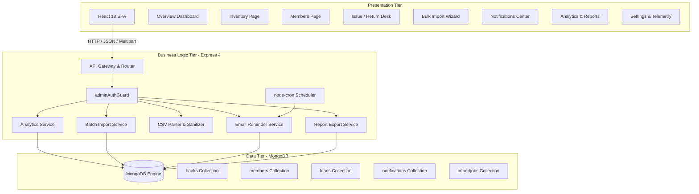
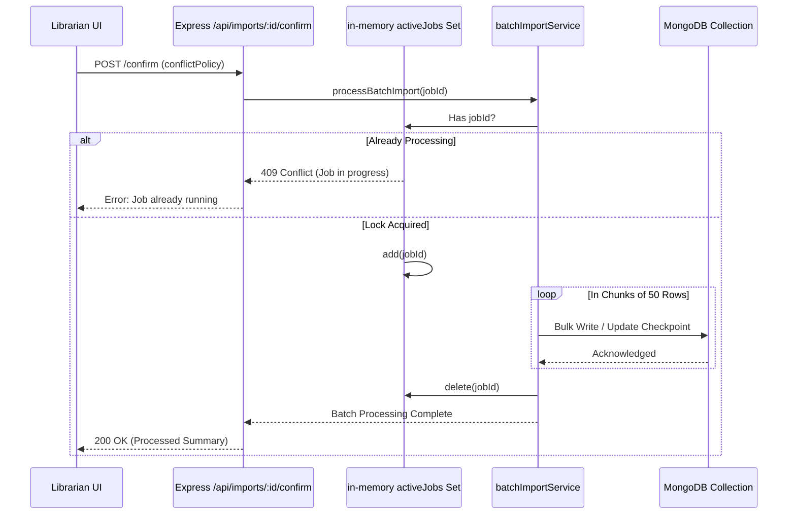

# System Design Document (SDD)

## LibTrack — Smart Library Management System
**Academic Project:** Visvesvaraya Technological University (VTU)  
**Degree:** B.E. in Computer Science & Engineering (2022 Scheme)  
**Document Version:** 1.0 (Final Submission Candidate)

---

## 1. System Architecture Overview

LibTrack employs a decoupled, modular three-tier architecture comprising a client single-page application (SPA), a stateless RESTful service layer, and a document-oriented database engine.



---

## 2. Core Service Components & Design Patterns

### 2.1 Batch Ingestion & Mutex Concurrency Pattern
When administrators upload bulk CSV catalogs containing thousands of records, concurrent execution could cause race conditions and memory exhaustion. LibTrack implements an **Atomic In-Memory Mutex Lock**:



### 2.2 Headless Background Scheduler & Idempotency Key Pattern
To prevent duplicate emails when the cron schedule fires repeatedly:
1. `node-cron` fires daily at 08:00 AM (`0 8 * * *`).
2. Evaluates active loans due in $\le 3$ days and loans past due.
3. Constructs an idempotency key:
   - Due-Soon: `{loanId}_DUE_SOON_{dueDate}`
   - First Overdue: `{loanId}_FIRST_OVERDUE_{dueDate}`
   - Repeat Overdue: `{loanId}_REPEAT_OVERDUE_cycle_{n}`
4. Checks existing `Notification` records in MongoDB for matching key before sending email.
5. If absent, sends email and atomically creates `Notification` record with status `SENT`.

---

## 3. MongoDB Aggregation Pipeline Design

### 3.1 12-KPI Operational Metrics Pipeline
Executes bounded parallel queries across collections:
```ts
const [titles, copiesAgg, members, activeLoans, overdueLoans, issued, returned] = await Promise.all([
  Book.countDocuments(),
  Book.aggregate([{ $group: { _id: null, totalCopies: { $sum: '$totalCopies' }, availableCopies: { $sum: '$availableCopies' } } }]),
  Member.countDocuments(),
  Loan.countDocuments({ status: 'ACTIVE' }),
  Loan.countDocuments({ $or: [{ status: 'OVERDUE' }, { status: 'ACTIVE', dueDate: { $lt: now } }] }),
  Loan.countDocuments({ issueDate: { $gte: startDate, $lte: endDate } }),
  Loan.countDocuments({ returnDate: { $gte: startDate, $lte: endDate } })
]);
```

### 3.2 Time-Series Circulation Trends Pipeline
```json
[
  { "$match": { "issueDate": { "$gte": "2026-09-15", "$lte": "2026-10-15" } } },
  { "$project": { "dateField": "$issueDate" } },
  {
    "$group": {
      "_id": {
        "year": { "$year": "$dateField" },
        "month": { "$month": "$dateField" },
        "day": { "$dayOfMonth": "$dateField" }
      },
      "count": { "$sum": 1 }
    }
  }
]
```

### 3.3 Most Borrowed Books Ranking Pipeline
```json
[
  { "$match": { "issueDate": { "$gte": "startDate", "$lte": "endDate" } } },
  { "$group": { "_id": "$book", "borrowCount": { "$sum": 1 } } },
  { "$sort": { "borrowCount": -1 } },
  { "$limit": 10 },
  { "$lookup": { "from": "books", "localField": "_id", "foreignField": "_id", "as": "book" } },
  { "$unwind": "$book" },
  { "$project": { "title": "$book.title", "isbn": "$book.isbn", "borrowCount": 1 } }
]
```

---

## 4. RESTful API Interface Specification

| Endpoint | Method | Guard | Description |
|---|---|---|---|
| `/api/health` | GET | Public | Database status, connection URI, server uptime |
| `/api/books` | GET, POST | Public / Admin | List/search books, create new book record |
| `/api/books/:id` | GET, PUT, DELETE | Public / Admin | Retrieve, update metadata, soft-archive book |
| `/api/members` | GET, POST | Public / Admin | Directory listing, register new student/faculty |
| `/api/loans/issue` | POST | Public | Checkout book, decrement available copies |
| `/api/loans/return` | POST | Public | Check-in book, increment available copies |
| `/api/notifications/run-reminders` | POST | Admin | Trigger background reminder checks |
| `/api/notifications/test-email` | POST | Admin | Dispatch test reminder to explicit email |
| `/api/imports/validate` | POST | Admin | Parse & pre-validate CSV upload |
| `/api/imports/:id/confirm` | POST | Admin | Execute chunked batch import (50/chunk) |
| `/api/imports/:id/error-report`| GET | Admin | Download sanitized CSV error log |
| `/api/analytics/summary` | GET | Admin | 12-KPI operational summary with date filter |
| `/api/analytics/circulation-trends` | GET | Admin | Daily/weekly/monthly issued vs returned series |
| `/api/analytics/reports/:type` | GET | Admin | Paginated tabular data for 7 reports |
| `/api/analytics/reports/:type/export` | GET | Admin | Streamed RFC 4180 CSV report export |

---

## 5. Security & Error Handling Architecture

1. **Centralized Error Middleware:** [`errorHandler.ts`](file:///C:/Users/bprin/.gemini/antigravity/scratch/libtrack/server/src/middleware/errorHandler.ts) catches unhandled rejections, formats standard JSON responses with error codes, and suppresses internal stack traces in production.
2. **Formula Injection Sanitization (CWE-1236):** [`csvParserService.ts`](file:///C:/Users/bprin/.gemini/antigravity/scratch/libtrack/server/src/services/csvParserService.ts#L18-L30) transforms potentially dangerous leading characters:
   ```ts
   if (/^[=+\-@\t\r]/.test(str)) {
     str = `'${str}`;
   }
   ```
3. **Database Availability Fallback:** When MongoDB is unreachable, the API returns `HTTP 503 Service Unavailable` with diagnostic troubleshooting steps rather than hanging or crashing.
