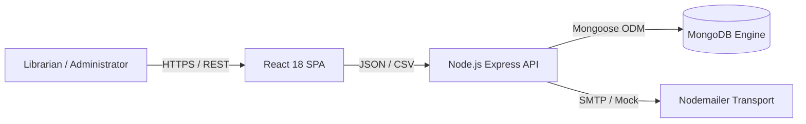

# Software Requirements Specification (SRS)

## LibTrack — Smart Library Management System
**Academic Project:** Visvesvaraya Technological University (VTU), Belagavi  
**Degree:** Bachelor of Engineering (B.E.) in Computer Science & Engineering  
**Scheme:** 2022 Scheme — 7th Semester  
**Course:** Big Data Project Laboratory  
**Revision:** 1.0 (Final Submission Candidate)

---

## 1. Introduction

### 1.1 Purpose
This Software Requirements Specification (SRS) details the functional and non-functional requirements for **LibTrack**, an institutional library management system engineered to automate book inventory tracking, student and faculty membership privileges, circulation workflows, email reminder dispatches, high-throughput bulk CSV batch ingestion, and time-series operational analytics.

### 1.2 Scope
LibTrack provides an integrated digital platform replacing legacy paper registers and manual spreadsheet-based library recordkeeping. It is specifically architected to demonstrate practical Big Data processing concepts—including bounded MongoDB aggregation pipelines, chunked batch processing with atomic mutex concurrency locks, and spreadsheet formula injection sanitization (CWE-1236)—within an academic university setting.

### 1.3 Definitions and Acronyms
- **ISBN:** International Standard Book Number (10 or 13 digits).
- **Mongoose:** Object Data Modeling (ODM) library for MongoDB and Node.js.
- **RFC 4180:** Common Format and MIME Type for Comma-Separated Values (CSV) Files.
- **CWE-1236:** Common Weakness Enumeration for Improper Neutralization of Formula Elements in CSV File.
- **Idempotency:** A property where an operation can be applied multiple times without changing the result beyond the initial application.
- **VTU:** Visvesvaraya Technological University.

---

## 2. Overall Description

### 2.1 Product Perspective
LibTrack is a self-contained, full-stack client-server application. It interfaces with MongoDB for persistent document storage and uses `node-cron` for scheduling background jobs. The system runs either against a persistent MongoDB instance or using an embedded in-memory database engine for local demonstrations.

### 2.2 User Roles & Privilege Matrix
1. **Librarian / Circulation Desk Staff:**
   - Catalog new book titles, update shelf locations, accession additional physical copies.
   - Register students and faculty members, update contact details, review clearance status.
   - Check out books to patrons, process returns, calculate overdue days.
2. **Library Administrator / Chief Librarian:**
   - Execute bulk CSV batch ingestion jobs for large catalog and patron acquisitions.
   - Configure email scheduler parameters (advance notice lead time, repeat overdue intervals).
   - Trigger manual reminder checks and administrative test emails.
   - Access comprehensive circulation intelligence, overdue risk analysis, and export audit reports to CSV.

### 2.3 General Constraints
- **Hardware Platform:** Standard x86-64 server or developer workstation.
- **Runtime Environment:** Node.js v18.0.0+ and modern web browsers (Chrome, Firefox, Edge, Safari).
- **Design System:** Strictly conforms to `design-system/libtrack/MASTER.md` (Academic Navy `#1B2A4A`, Academic Teal `#0D9488`, slate neutrals, Lucide icons).
- **Single Source of Truth:** Authoritative book availability is maintained in `Book.availableCopies`. Borrowing cannot decrement available copies below zero.

---

## 3. Specific Functional Requirements

### 3.1 Book Inventory Management (FR-01 to FR-05)
- **FR-01 (Book Registration):** System shall validate book title, ISBN, author list, academic category, shelf location, and physical copy counts.
- **FR-02 (ISBN Checksum & Normalization):** System shall strip hyphens and validate both ISBN-10 and ISBN-13 formats, rejecting duplicate ISBN entries.
- **FR-03 (Inventory Invariant):** System shall enforce `0 <= availableCopies <= totalCopies`. Total copies cannot be reduced below the count of active loans currently in circulation.
- **FR-04 (Catalog Search & Filtering):** System shall provide case-insensitive full-text search across titles, authors, and ISBNs with category and availability filters.
- **FR-05 (Soft Deletion):** System shall prevent hard deletion of book titles that have active or overdue loans in circulation.

### 3.2 Member & Patron Management (FR-06 to FR-09)
- **FR-06 (Member Registration):** System shall register members with unique `memberId` (e.g. `STU-YYYY-XXXX` or `FAC-YYYY-XXXX`), full name, valid email address, and academic department.
- **FR-07 (Quota Enforcement):** System shall enforce borrowing quotas based on member type (maximum 4 books for `STUDENT`, 10 books for `FACULTY`).
- **FR-08 (Membership Status):** System shall prevent inactive, suspended, or expired members from borrowing books.
- **FR-09 (Patron History):** System shall maintain an audit trail of active and historical borrowing events for every registered patron.

### 3.3 Book Issue & Return Circulation (FR-10 to FR-14)
- **FR-10 (Checkout Validation):** System shall ensure the requested book has `availableCopies > 0`, the borrower has not reached their borrow quota, and the borrower has no overdue holds.
- **FR-11 (Atomic Inventory Decrement):** Upon checkout, system shall decrement `availableCopies` by 1 and record a loan record with `issueDate`, `dueDate` (default 14 days), and `status: 'ACTIVE'`.
- **FR-12 (Check-in Processing):** Upon return, system shall increment `availableCopies` by 1, record `returnDate`, update loan status to `'RETURNED'`, and immediately cease any future overdue reminders.
- **FR-13 (Return Idempotency):** System shall reject attempts to return an already-returned loan.
- **FR-14 (Overdue Detection):** Loans with `dueDate < now` and `status === 'ACTIVE'` shall automatically transition to `'OVERDUE'`.

### 3.4 Automated Email Reminders (FR-15 to FR-18)
- **FR-15 (Advance Due-Soon Notices):** System shall identify active loans due in $\le 3$ days and dispatch email notices with book title, shelf location, and desk return hours.
- **FR-16 (First & Repeat Overdue Notices):** System shall dispatch a first overdue notice immediately upon deadline lapse and repeat overdue notices every 7 days thereafter.
- **FR-17 (Idempotency Keying):** Each notification shall generate a unique idempotency key (`{loanId}_{type}_{cycle}`) ensuring zero duplicate emails across repeated scheduler runs.
- **FR-18 (Mock Transport Fallback):** When external SMTP credentials are not configured, the system shall safely log all reminder events to the database without throwing runtime errors.

### 3.5 Bulk CSV Import & Batch Processing (FR-19 to FR-23)
- **FR-19 (RFC 4180 Parsing):** System shall parse CSV files containing quoted fields, embedded commas, and UTF-8 Byte Order Marks (BOM).
- **FR-20 (Row-Level Validation):** System shall validate all candidate rows before database insertion, generating structured row-specific error messages.
- **FR-21 (Duplicate Detection & Conflict Policies):** System shall detect in-file duplicates and database collisions, supporting `SKIP_DUPLICATES`, `REJECT_CONFLICTS`, and `UPDATE_EXISTING`.
- **FR-22 (Chunked Batch Ingestion & Mutex):** System shall process valid records in batches of 50 rows with an in-memory mutex to prevent concurrent worker collisions.
- **FR-23 (Safe Partial Retry):** System shall allow librarians to retry failed rows without duplicating previously successful records.

### 3.6 Analytics, KPIs & Compliance Reporting (FR-24 to FR-28)
- **FR-24 (12 Operational KPIs):** System shall aggregate catalog holdings, patron enrollment, active circulation, delinquent volumes, and automation telemetry.
- **FR-25 (Circulation Time Series):** System shall calculate dual-series borrowing vs. return velocity grouped by day, week, or month.
- **FR-26 (Overdue Severity Buckets):** System shall group overdue loans into 1–7d, 8–14d, 15–30d, and 30+d risk categories.
- **FR-27 (Tabular Reports):** System shall generate 7 institutional audit reports (Inventory, Circulation, Overdue, Popular Books, Member Activity, Notification Logs, Bulk Import History).
- **FR-28 (Sanitized CSV Export):** System shall export reports to RFC 4180 CSV with formula injection protection (CWE-1236).

---

## 4. Non-Functional Requirements

### 4.1 Performance & Scalability
- **NFR-01:** Dashboard KPI metrics and Recharts time-series aggregations shall execute in under 200 ms for up to 100,000 loan records using compound indexes.
- **NFR-02:** Bulk CSV import shall process 5,000 rows in under 15 seconds through 50-row chunked batching.

### 4.2 Security & Integrity
- **NFR-03 (Authentication Guard):** All administrative and reporting endpoints require `x-admin-key: 'libtrack-admin-secret-2024'` or an administrator token.
- **NFR-04 (PII Protection):** Member aggregate analytics omit personal email addresses and contact phone numbers.
- **NFR-05 (Formula Injection):** All user-supplied values in CSV exports are sanitized to neutralize spreadsheet formulas.

### 4.3 Reliability & Availability
- **NFR-06:** The system gracefully falls back to mock transport when SMTP is offline and includes embedded in-memory MongoDB for offline evaluations.
