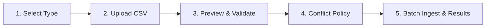

# Operator & User Manual

## LibTrack — Smart Library Management System
**Academic Project:** Visvesvaraya Technological University (VTU)  
**Target Audience:** Library Administrators, Circulation Desk Staff, System Operators  
**Document Version:** 1.0 (Final Submission Candidate)

---

## 1. Accessing the System & Dashboard Overview

1. Open your web browser and navigate to:  
   `http://localhost:5173`
2. Ensure the backend server is running on port 5000. The green **Database Connected** indicator in the top header confirms live connectivity to MongoDB.
3. The **Overview Dashboard** provides an immediate 12-KPI operational summary:
   - **Catalog Titles & Physical Copies:** Total books accessioned in the library.
   - **Registered Patrons:** Active students and faculty members.
   - **Active Loans & Overdue Volumes:** Live status of books currently checked out.
   - **Circulation Velocity:** Borrow and return counts over the past 30 days.
   - **Automation Health:** Count of sent due-soon alerts, overdue notices, and bulk import jobs.

---

## 2. Book Inventory Catalog Management

### 2.1 Adding a New Book Title
1. Click **Book Inventory** on the sidebar.
2. Click the **+ Add Book** button in the upper right corner.
3. Complete the modal form:
   - **Title:** e.g., *Database System Concepts*
   - **ISBN:** 10 or 13 digits (e.g. `978-0078022159`). Hyphens are automatically stripped.
   - **Authors:** Multiple authors separated by commas.
   - **Academic Category:** e.g., *Computer Science & Engineering*
   - **Shelf Location:** e.g., *Stack CS-07*
   - **Total Copies:** Minimum 1 physical copy.
4. Click **Save Book Record**. The record is validated and saved to MongoDB.

### 2.2 Searching & Filtering Books
- Type any keyword in the search bar to search across titles, authors, and ISBN numbers.
- Use the **Category** dropdown to filter books by academic department.
- Use the **Availability** toggle to view only books currently shelved on stacks.

---

## 3. Member Directory Management

### 3.1 Registering a New Patron
1. Click **Members** on the sidebar.
2. Click **+ Add Member**.
3. Fill in the student or faculty member details:
   - **Member ID:** Institutional USN or Employee ID (e.g. `STU-2026-1045`).
   - **Full Name:** Patron's legal name.
   - **Email:** Official college email address (used for automated return reminders).
   - **Department:** Academic branch (e.g. *Computer Science & Engineering*).
   - **Member Tier:** Select `STUDENT` (max 4 books) or `FACULTY` (max 10 books).
4. Click **Create Member**.

---

## 4. Circulation Desk: Book Issue & Return Workflows

### 4.1 Checking Out a Book (Issue Workflow)
1. Click **Issue & Return** on the sidebar.
2. Under the **Issue Book** tab:
   - **Step 1:** Search for the student by name or Member ID and click to select.
   - **Step 2:** Search for the book title or scan the ISBN and click to select.
   - **Step 3:** Choose the loan duration (default: 14 days) and add optional condition notes.
3. Click **Issue Book to Member**.
4. The system validates availability, decrements `availableCopies` by 1, and creates an active loan record.

### 4.2 Checking In a Book (Return Workflow)
1. Switch to the **Return Book** tab on the circulation page.
2. Locate the active loan using the search bar (filter by member ID or book title).
3. If a book is overdue, the system displays the overdue duration and fine badge.
4. Click **Process Return**. Confirm any check-in notes.
5. The book's available copies are incremented by 1, and the loan transitions to `RETURNED`.

---

## 5. Bulk CSV Data Ingestion & Batch Processing

When adding new book acquisitions or registering incoming student batches:

1. Click **Bulk Data Import** on the sidebar.
2. **Step 1 — Download Template:** Click **Download Books Template** or **Download Members Template** to retrieve the official CSV format.
3. **Step 2 — File Upload:** Drag and drop your populated `.csv` file.
4. **Step 3 — Pre-Validation Preview:** Review the real-time summary bar. Inspect candidate rows: green badges denote valid records; red badges display exact row-level syntax errors.
5. **Step 4 — Select Conflict Policy:**
   - `SKIP_DUPLICATES`: Discards duplicate records and inserts only new records.
   - `REJECT_CONFLICTS`: Aborts the entire import if any collision is found.
   - `UPDATE_EXISTING`: Updates existing metadata while preserving active loan counts.
6. **Step 5 — Confirm & Ingest:** Click **Confirm and Process**. Data is committed in atomic batches of 50 rows.
7. Download the sanitized CSV error log if partial failures occur, or click **Retry Failed Records**.

---

## 6. Automated Email Reminders & Notifications

1. Click **Email Notifications** on the sidebar.
2. **Scheduler Telemetry:** Inspect the active cron frequency (`0 8 * * *`) and advance notice lead time (3 days).
3. **Audit History Table:** View all sent, pending, and failed reminders with recipient emails, book references, and dispatch timestamps.
4. **Run Reminders Manually:** Click **Evaluate & Send Reminders** to trigger an immediate background check without waiting for the daily cron.
5. **Send Test Email:** Use the diagnostic tool to send a sample reminder notice to an administrator's email address.

---

## 7. Advanced Analytics & Compliance Reports

1. Click **Analytics & Reports** on the sidebar.
2. **Date Range Filter:** Choose a preset (`Today`, `7D`, `30D`, `90D`, `Month`) or select a **Custom Range** (`YYYY-MM-DD`).
3. **Visual Analytics Tab:**
   - Inspect dual-series circulation trends (Issued vs. Returned) with daily, weekly, or monthly grouping.
   - Review the Most Borrowed Books leaderboard and Category borrowing velocity.
   - Examine overdue severity buckets (1–7d, 8–14d, 15–30d, 30+d) and critical low-stock warnings.
4. **Audit Reports & CSV Exports Tab:**
   - Select between the 7 supported institutional reports:
     1. Inventory Master Catalog
     2. Circulation Activity Audit
     3. Current Overdue & Defaulters List
     4. Most Borrowed Books Ranking
     5. Patron Borrowing Activity Directory
     6. Automated Email Reminders Audit Log
     7. Bulk Data Import Job History
   - Type in the search box to filter records.
   - Click **Export CSV Report** to download an injection-sanitized RFC 4180 CSV file matching your active filters.

---

## 8. Troubleshooting & Common Questions

| Issue | Cause | Solution |
|---|---|---|
| **Database Disconnected (HTTP 503)** | Local MongoDB instance is not running. | Run `npm run dev:memory` in the `server` folder to launch the built-in in-memory MongoDB engine. |
| **Email reminders in MOCK_TRANSPORT** | SMTP credentials omitted from `.env`. | This is normal for local testing. Reminders are logged to the database without making external network calls. |
| **Bulk CSV Import Rejected** | Missing required columns or file size > 10 MB. | Download the official template from Step 1 of the Import wizard and ensure all headers match. |
| **Cannot delete a book** | Book has active or overdue loans. | Active loans must be returned at the circulation desk before a volume can be archived. |
