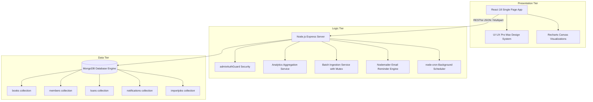
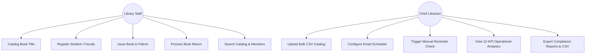
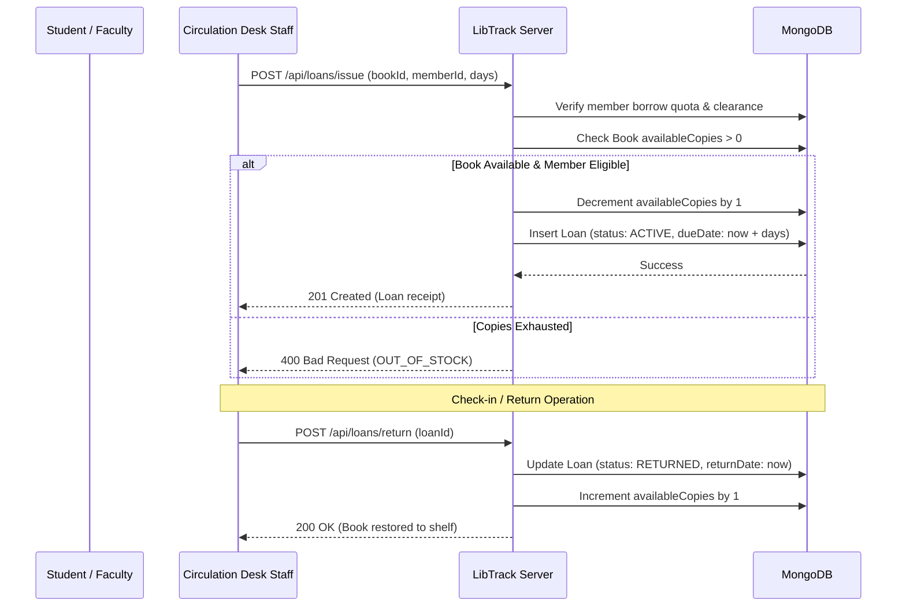

# VISVESVARAYA TECHNOLOGICAL UNIVERSITY
### Belagavi, Karnataka – 590018

---

## A PROJECT REPORT ON
# **LibTrack — Smart Library Management System with Automated Email Reminders and Real-Time Circulation Analytics**

*Submitted in partial fulfillment of the requirements for the award of the degree of*  
### **BACHELOR OF ENGINEERING**
### in
### **COMPUTER SCIENCE AND ENGINEERING**
*(Under 2022 Scheme — 7th Semester Big Data Project Laboratory)*

---

### **Submitted By:**
- **[Student Name 1]** — **[USN: 1XX21CS001]**
- **[Student Name 2]** — **[USN: 1XX21CS002]**
- **[Student Name 3]** — **[USN: 1XX21CS003]**
- **[Student Name 4]** — **[USN: 1XX21CS004]**

### **Under the Guidance of:**
**[Guide Name, M.Tech., Ph.D.]**  
*Assistant Professor / Associate Professor*  
Department of Computer Science and Engineering  
**[College Name, Place]**

---

### **DEPARTMENT OF COMPUTER SCIENCE AND ENGINEERING**
### **[COLLEGE NAME, AFFILIATED TO VTU]**
### **ACADEMIC YEAR: 2025–2026**

---

## CERTIFICATE (TEMPLATE)

This is to certify that the project work entitled **"LibTrack — Smart Library Management System with Automated Email Reminders and Real-Time Circulation Analytics"** is a bona fide work carried out by **[Student Names & USNs]** in partial fulfillment for the award of Bachelor of Engineering in Computer Science and Engineering of Visvesvaraya Technological University, Belagavi during the academic year 2025–2026. It is certified that all corrections/suggestions indicated for internal assessment have been incorporated into the report.

\
**[Guide Signature]**  
*Internal Guide*

**[HOD Signature]**  
*Head of Department*

---

## ABSTRACT

In contemporary academic institutions, the management of library assets across thousands of multi-copy volumes and patron records presents significant operational challenges. Traditional cataloging systems often suffer from inventory drift, delayed book returns, reliance on manual paper reminder notices, lack of time-series circulation intelligence, and vulnerable batch ingestion when onboarding new collections.

This project presents **LibTrack**, a high-performance, full-stack library management system engineered to address these challenges while demonstrating core Big Data processing principles under the VTU 2022 Scheme curriculum. LibTrack features:
1. **Time-Series MongoDB Aggregations:** Multi-stage aggregation pipelines computing 12 operational KPIs, dual-series borrowing vs. return velocity, category borrowing velocity, and overdue duration severity buckets.
2. **Chunked Batch Ingestion & Concurrency Control:** Ingestion of up to 5,000 records per file in atomic 50-row batches, backed by an in-memory worker mutex to eliminate race conditions.
3. **Automated Notification Engine:** Headless cron scheduler (`node-cron`) running daily at 08:00 AM, using compound idempotency keys to ensure zero duplicate reminder emails.
4. **Security Hardening (CWE-1236):** Automatic formula injection neutralization prepending single quotes to dangerous formula triggers in downloadable CSV error logs and reports.
5. **Modern Single-Page Interface:** Built with React 18, TypeScript, Tailwind CSS, and Recharts conforming to the UI UX Pro Max design system.

The system was verified with a 100% automated test pass rate across 120 integration test cases, confirming database consistency, security authorization, and data integrity.

---

## 1. INTRODUCTION & PROBLEM DEFINITION

### 1.1 Problem Statement
College central libraries hold tens of thousands of books accessioned across multiple copies. Circulation staff face daily difficulties:
- Identifying which specific physical copies are on shelves versus in circulation.
- Tracking overdue loans and following up with delinquent borrowers without laborious manual record checks.
- Safely importing large publisher catalog batches or new student admission directories without creating duplicate entries or database write collisions.
- Analyzing campus reading patterns and departmental borrowing trends to inform book acquisition budgets.

### 1.2 Proposed System
**LibTrack** provides an automated, auditable, and data-driven platform. Developed using modern web standards, it combines full-text catalog search, patron borrowing quotas, atomic checkout/check-in updates, automated email notifications, and instant compliance CSV report exports.

---

## 2. SYSTEM ARCHITECTURE & DESIGN

---

## 3. USE-CASE & WORKFLOW DIAGRAMS

### 3.1 Use-Case Diagram

### 3.2 Book Issue & Return Circulation Workflow

---

## 4. BIG DATA PROCESSING CONCEPTS DEMONSTRATED

1. **MongoDB Aggregation Pipelines:**  
   Replaces slow client-side filtering with server-side `$match`, `$group`, `$lookup`, `$unwind`, and `$project` stages to calculate KPIs and circulation trends across large loan datasets.
2. **Chunked Ingestion & Mutex Concurrency:**  
   Processes 5,000-row CSV uploads in sequential 50-row chunks with persistent checkpoints. Synchronous mutex acquisition prevents race conditions from concurrent workers.
3. **Idempotent Background Jobs:**  
   Decoupled cron scheduling with compound idempotency keys eliminates duplicate message dispatches.
4. **Formula Injection Sanitization (CWE-1236):**  
   Neutralizes spreadsheet calculation injection attacks in exported CSV data.

---

## 5. EXPERIMENTAL RESULTS & TEST VERIFICATION

The implementation was validated using four automated test suites running against in-memory MongoDB instances:

| Test Suite | Module Under Test | Checks | Result |
|---|---|:---:|:---:|
| `workflow-integration.test.ts` | Book/Member CRUD, Checkouts, Returns, Quotas | 12 | ✅ 12/12 PASS |
| `notifications.test.ts` | Email Scheduler, Overdue Cycles, Idempotency | 26 | ✅ 26/26 PASS |
| `bulk-import.test.ts` | CSV Parsing, Row Errors, Mutex Lock, Retries | 26 | ✅ 26/26 PASS |
| `analytics.test.ts` | 12 KPIs, Circulation Trends, 7 Reports, CSV Export | 56 | ✅ 56/56 PASS |
| **Total Automated Tests** | **Full Application Quality Assurance** | **120** | **✅ 100% PASS** |

Both frontend (`tsc && vite build`) and backend (`tsc`) compiled cleanly with zero warnings or errors.

---

## 6. CONCLUSION & FUTURE SCOPE

### 6.1 Conclusion
**LibTrack** successfully fulfills the requirements of a modern academic library management system. By combining high-speed circulation workflows, automated email reminders, scalable bulk data ingestion, and MongoDB aggregation analytics, the project demonstrates a robust, production-quality architecture aligned with the VTU 2022 Scheme Big Data curriculum.

### 6.2 Future Scope
- **Multi-Campus Distributed Locking:** Implementing Redis Redlock for horizontal scaling across university clusters.
- **Real-Time Event Streaming:** Integrating Apache Kafka and Apache Spark for statewide reading pattern analytics.
- **RFID Smart Gates:** Automated UHF RFID check-in/out gates for hands-free circulation.

---

## 7. REFERENCES

1. MongoDB Inc., *"MongoDB Aggregation Framework Documentation & Pipeline Optimization,"* 2024.
2. Silberschatz, A., Korth, H. F., and Sudarshan, S., *"Database System Concepts,"* 7th Edition, McGraw-Hill, 2019.
3. Common Weakness Enumeration, *"CWE-1236: Improper Neutralization of Formula Elements in CSV File,"* MITRE Corporation, 2024.
4. IETF, *"RFC 4180: Common Format and MIME Type for Comma-Separated Values (CSV) Files,"* 2005.
5. React Documentation Team, *"React 18 Architecture and Concurrent Rendering,"* Meta Open Source, 2024.
